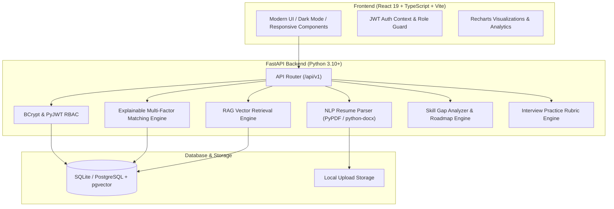

<div align="center">

# 🚀 HireWise AI
### Enterprise Full-Stack AI-Powered Recruitment, Resume Intelligence & Job Recommendation System

[](https://python.org)
[](https://fastapi.tiangolo.com)
[](https://react.dev)
[](https://www.typescriptlang.org)
[](https://vitejs.dev)
[](https://www.docker.com)
[](https://docs.pytest.org)

<p align="center">
  <b>Bridging Candidates, Recruiters, and Administrators with Explainable AI, Semantic RAG Retrieval, and Ethical Matching.</b>
</p>

[Key Features](#-key-features) •
[System Architecture](#-system-architecture) •
[Tech Stack](#-technology-stack) •
[Quick Start](#-quick-start-guide) •
[Demo Accounts](#-demo-login-accounts) •
[Testing](#-automated-testing) •
[Project Structure](#-project-structure)

</div>

---

## 📖 Overview

**HireWise AI** is an enterprise-grade recruitment, resume intelligence, and career recommendation platform. It connects candidates, recruiters, and administrators through explainable multi-factor matching algorithms, deterministic NLP resume parsing, semantic vector retrieval (RAG), and interactive interview preparation.

Built with an emphasis on **fair hiring compliance**, HireWise AI evaluates candidates strictly on verified skills, project demonstrations, and work credentials—eliminating demographic bias from automated ATS pipelines.

---

## ✨ Key Features

### 📄 1. NLP Resume Extraction & Intelligence
- **Multi-Format Parsing**: Supports native **PDF** and **DOCX** document uploads.
- **Automated Skill Taxonomy**: Categorizes extracted competencies into 6 technical domains:
  - *Programming Languages*
  - *Frameworks & Libraries*
  - *Databases & Caching*
  - *Cloud & DevOps*
  - *AI & Data Science*
  - *Architecture & Methodologies*
- **ATS Completeness Audit**: Evaluates resumes on a **0–100% scale** with real-time actionable optimization recommendations.

### 🎯 2. Explainable Multi-Factor Job Matching
Eliminates black-box rejections by providing a fully transparent, mathematical score breakdown (0–100):
- **40% Required Skills Match**: Direct comparison against mandatory job prerequisites.
- **30% Semantic Similarity**: Cosine vector similarity comparing resume context with job descriptions.
- **20% Experience & Projects Match**: Work history depth and demonstrated project alignment.
- **10% Preferred Skills Match**: Bonus points for nice-to-have capabilities.
- **Ethical AI Guarantee**: Scored exclusively on merit and job-relevant evidence without demographic characteristics (no gender, race, religion, or age bias).

### 🤖 3. RAG-Augmented AI Career Advisor
- Intelligent career assistant grounded in authorized platform career guidelines.
- **Citation Attribution**: Explicitly cites retrieved source titles and guidance modules.
- **Deterministic Offline Fallback**: Operates without external LLM API dependencies with transparent fallback status.

### 🎙️ 4. AI Interview Simulator & Rubric Evaluation
- Role-specific mock interview simulations for:
  - *Full Stack Developer*
  - *Backend Engineer*
  - *Frontend Specialist*
  - *AI & Machine Learning Engineer*
- Generates technical, coding, architectural, and behavioral questions.
- **Rubric-Based Grading**: Evaluates responses across *Relevance, Correctness, Explanation Quality, and Problem Solving*.

### 🗺️ 5. Skill Gap Analysis & Verified Learning Roadmap
- Instant gap audit identifying missing competencies for target job listings.
- Direct links to **verified official documentation** (Python, React, Docker, Kubernetes, PostgreSQL, FastAPI, AWS).
- Architecture blueprints for portfolio practice projects and milestone schedules.

### 👥 6. Recruiter & ATS Pipeline Management
- Complete job requisition lifecycle: create, publish, and manage job listings with mandatory vs. preferred skills.
- **AI Recruitment Summary**: Synthesizes applicant qualifications into actionable briefing notes for hiring managers.
- Human-in-the-loop candidate screening pipeline (*Applied* → *Under Review* → *Shortlisted* → *Interview* → *Decision*).

### 📊 7. Admin Telemetry & Audit Logs
- Platform-wide telemetry and interactive analytics powered by **Recharts**.
- Top demanded skills visualization, role distributions, and application status funnels.
- Immutable, tamper-evident audit logging of system and agent activities.

---

## 🏗️ System Architecture



---

## 🛠️ Technology Stack

| Layer | Technologies |
|---|---|
| **Frontend** | React 19, TypeScript, Vite, Custom Vanilla CSS Design System, Recharts, Lucide Icons |
| **Backend** | Python 3.10+, FastAPI, Pydantic v2, SQLAlchemy ORM, Uvicorn |
| **Document Processing** | PyPDF, python-docx |
| **AI / NLP** | Regex entity extraction, Skill Taxonomy mapping, Cosine Similarity, RAG Vector Search |
| **Security & Auth** | BCrypt password hashing, PyJWT Bearer Authentication, Role-Based Access Control (RBAC) |
| **Database** | SQLite (zero-config local dev) / PostgreSQL with pgvector (production) |
| **Testing** | Pytest automated test suite (unit, service, and security integration tests) |
| **Containerization** | Docker, Docker Compose |

---

## 🚀 Quick Start Guide

### Prerequisites
- **Python**: 3.10 or higher
- **Node.js**: 20 or higher
- **Git**

---

### Option A: Local Development (Recommended)

#### 1. Backend Setup
```bash
# Navigate to backend directory
cd backend

# Install Python dependencies
pip install -r requirements.txt

# Launch FastAPI development server (auto-seeds database on startup)
python -m uvicorn app.main:app --host 0.0.0.0 --port 8000 --reload
```
- API Server: `http://localhost:8000`
- Interactive OpenAPI Docs: `http://localhost:8000/docs`
- Alternative ReDoc: `http://localhost:8000/redoc`

#### 2. Frontend Setup
```bash
# Open a new terminal and navigate to frontend
cd frontend

# Install dependencies
npm install --legacy-peer-deps

# Start Vite dev server
npm run dev
```
- Frontend Application: `http://localhost:5173`

---

### Option B: Docker Compose Deployment

Run the complete stack (FastAPI backend + Nginx frontend + PostgreSQL) with a single command:
```bash
docker-compose up --build
```

---

## 🔑 Demo Login Accounts

HireWise AI comes pre-seeded with realistic test accounts for immediate evaluation:

| Role | Email | Password | Access Capabilities |
|---|---|---|---|
| 👨‍💻 **Candidate** | `alex@developer.io` | `Candidate123!` | Resume Upload, Score Breakdown, Gap Analysis, Interview Simulator |
| 💼 **Recruiter** | `recruiter@techventures.com` | `Recruiter123!` | Job Posting, Pipeline Management, AI Applicant Summary |
| 🛡️ **Administrator** | `admin@hirewise.ai` | `Admin123!` | Platform Telemetry, Skill Demand Analytics, Audit Logs |

> **Tip**: One-click demo credentials auto-fill buttons are available directly on the login screen for instant testing.

---

## 🧪 Automated Testing

The automated test suite validates the core security, NLP parsing, matching calculations, and retrieval logic:

```bash
# Run the test suite from the root directory
python -m pytest backend/tests/test_hirewise.py -v
```

### Verified Test Cases:
1. `test_password_hashing_and_verification`: BCrypt cryptographic security validation.
2. `test_jwt_token_generation_and_decoding`: PyJWT token generation, claims, and role decoding.
3. `test_nlp_skill_extraction`: NLP taxonomy extraction across technical skill categories.
4. `test_nlp_completeness_calculation`: ATS checklist and completeness score evaluation.
5. `test_job_matching_engine`: Explainable 4-factor scoring (40% / 30% / 20% / 10%).
6. `test_skill_gap_analysis`: Gap audit with verified official documentation linking.
7. `test_interview_prep_and_evaluation`: Question generation and 4-metric rubric scoring.
8. `test_rag_retrieval`: Grounded semantic retrieval with citation attribution.

---

## 📁 Project Structure

```
hirewise-ai/
├── backend/
│   ├── app/
│   │   ├── ai/
│   │   │   ├── agents/          # AI Orchestrator & recruitment summary agent
│   │   │   └── rag/             # Grounded RAG vector retrieval engine
│   │   ├── api/                 # REST API route handlers
│   │   │   ├── admin.py         # Telemetry and audit log endpoints
│   │   │   ├── ai.py            # AI assistant and interview prep endpoints
│   │   │   ├── applications.py  # ATS job application workflows
│   │   │   ├── auth.py          # Authentication and token issuance
│   │   │   ├── deps.py          # FastApi dependencies & security guards
│   │   │   ├── jobs.py          # Job posting and discovery endpoints
│   │   │   ├── matches.py       # Explainable matching calculations
│   │   │   ├── resumes.py       # Resume parsing & completeness endpoints
│   │   │   └── router.py        # Central API router aggregator
│   │   ├── core/                # Core configurations, JWT security, DB session
│   │   ├── database/            # Database initialization and seed data
│   │   ├── models/              # SQLAlchemy relational models
│   │   ├── schemas/             # Pydantic v2 validation models
│   │   └── services/            # NLP extractor, parser, matching engine, gap analyzer
│   ├── tests/                   # Pytest test suite
│   ├── uploads/                 # Local upload storage directory
│   ├── Dockerfile               # Backend Dockerfile
│   └── requirements.txt         # Python dependencies
├── frontend/
│   ├── public/                  # Public assets and icons
│   ├── src/
│   │   ├── assets/              # Static media assets
│   │   ├── components/          # Reusable UI components (Navbar, Sidebar, ScoreMeter, etc.)
│   │   ├── hooks/               # Custom React hooks (useAuth, theme)
│   │   ├── pages/               # 18 fully responsive page views
│   │   ├── services/            # Axios / Fetch API client
│   │   ├── types/               # TypeScript interface definitions
│   │   ├── App.tsx              # Main routing and navigation
│   │   ├── index.css            # Custom responsive CSS design system
│   │   └── main.tsx             # React DOM entry point
│   ├── Dockerfile               # Frontend Dockerfile
│   ├── package.json             # NPM package manifest
│   └── vite.config.ts           # Vite build configuration
├── .env.example                 # Environment configuration template
├── .gitignore                   # Standard Git ignore rules
├── docker-compose.yml           # Full-stack container orchestration
├── README.md                    # Main project documentation
└── TESTING_README.md            # In-depth test suite documentation
```

---

## 🔒 Security & Fair Hiring Compliance

- **Role-Based Access Control (RBAC)**: Strict route protection across Candidate, Recruiter, and Admin privileges.
- **Password Security**: Strong salt hashing with BCrypt.
- **Unbiased Hiring**: Demographic attributes (race, gender, age, religion, photos) are strictly disregarded during matching and AI candidate synthesis.
- **Audit Trails**: All recruitment and matching actions are immutably logged for governance.

---

## 👤 Author

Developed by **Pasala Adharsh** ([@adharsh2005-13](https://github.com/adharsh2005-13))

GitHub Profile: [https://github.com/adharsh2005-13](https://github.com/adharsh2005-13)
